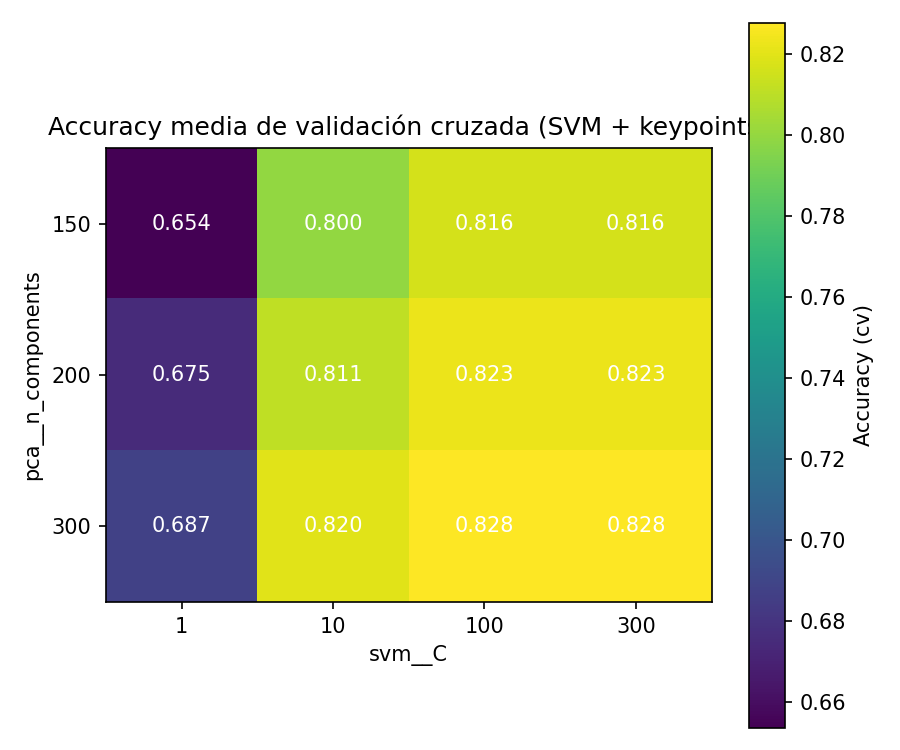
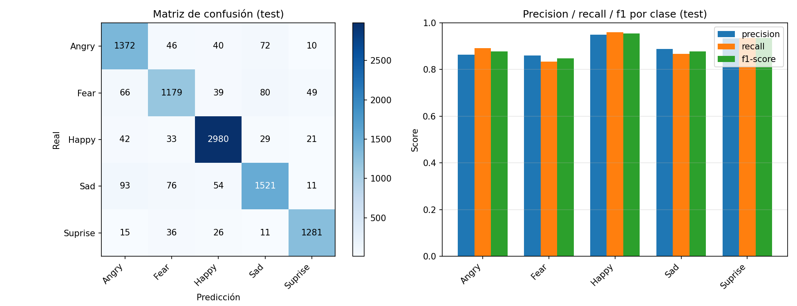

# EmotionDetector

## Dataset

El dataset utilizado se puede encontrar y descargar a través del siguiente [enlace](https://www.kaggle.com/datasets/samithsachidanandan/human-face-emotions/data)

## Especificaciones del equipo utilizado

Todo el desarrollo de la práctica se realizó en un portátil con las siguientes características:

- CPU: AMD Ryzen 7 7735HS with Radeon Graphics.
- GPU: NVIDIA GeForce RTX 4050 Laptop, CUDA 12.6.
- RAM: 16GB DDR5 4800 MT/s

## Detección de emociones

### Instalación de los entornos utilizados

Para realizar esta tarea sin generar conflictos entre las distintas dependencias se crearon dos entornos distintos: uno para los modelos propios de la práctica, que necesita versiones antiguas de varias dependencias para poder entrenar la `CNN` con aceleración por GPU en Windows, y otro para `Mediapipe`, cuyas dependencias son incompatibles con las fijadas en el primero.

#### Entorno para los modelos (`MTCNN`, `Eigenfaces + SVM` y `CNN`)

Este entorno agrupa el procesado del dataset para la detección de caras con `MTCNN` y los entrenamientos para las emociones con `Eigenfaces + SVM` y `CNN`, ya que ninguno de los tres introduce conflictos de dependencias entre sí. Dado que no existe soporte nativo para GPU en Windows a partir de `TensorFlow 2.11`, el entrenamiento de la `CNN` con GPU obliga a usar una versión anterior (`2.10`) junto con el plugin `DirectML`, el cual a su vez solo admite Python hasta la versión `3.10` (no soporta 3.11 en adelante):

```bash
conda create --name VC_Emotion_gpu python=3.10
conda activate VC_Emotion_gpu

pip install "tensorflow-cpu==2.10.0" "tensorflow-directml-plugin" "keras>=2.10.0,<2.11" "protobuf>=3.9.2,<3.20" "numpy<2"
pip install matplotlib scikit-learn joblib ipykernel mtcnn
pip install opencv-python==4.9.0.80 --force-reinstall --no-deps
```

`tensorflow-directml-plugin` solo es compatible con `tensorflow-cpu==2.10.0`, lo que obliga a fijar `keras` en su rama `2.10` (a partir de `Keras 3` deja de ser compatible con esta versión de `TensorFlow`) y `protobuf` por debajo de la `3.20`. Esto también obliga a mantener `numpy` por debajo de la versión `2`, ya que `TensorFlow 2.10` no es compatible con ella. Por último, instalar `mtcnn` y `scikit-learn` termina actualizando `opencv-python` a una versión más reciente, por lo que es necesario reinstalar la versión deseada (`4.9.0.80`) indicando `--no-deps` para que no vuelva a actualizar `numpy` ni `protobuf` a una versión incompatible con el resto.

Cabe destacar que, al ser `tensorflow-directml-plugin` un proyecto de Microsoft actualmente discontinuado y sin nuevas versiones, no se garantiza su compatibilidad con futuras actualizaciones de los drivers de NVIDIA o de Windows.

Otro inconveniente con este entorno es que cuenta con ciertas funciones que no soporta nativamente en GPU, por lo que las ejecutará en CPU sin avisar y tendrá un rendimiento inferior a realizar la instalación mediante `WSL`. No obstante, no se considera imprescindible el rendimiento y velocidad de ejecución para esta práctica, por lo que se sacrificó a cambio de una implementación más simple.

#### Entorno para el uso de `Mediapipe` y demo

Este segundo entorno se usa para la extracción de `keypoints` faciales con `Mediapipe`, tanto en el dataset procesado como en la demo final. Se separa del entorno anterior porque `mediapipe` requiere `protobuf>=4.25.3,<5`, un rango incompatible con el `protobuf<3.20` que exige `tensorflow-directml-plugin`, por lo que no es posible instalar ambos conjuntos de dependencias en un mismo entorno. Al no depender de `TensorFlow` para sus propios modelos, `Mediapipe` no necesita del plugin `DirectML` ni de una versión antigua de Python, por lo que aquí se usan versiones estándar del resto de dependencias:

```bash
conda create --name VC_Emotion_mediapipe python=3.11
conda activate VC_Emotion_mediapipe

pip install "numpy<2"
pip install tensorflow tf-keras deepface mediapipe scikit-learn joblib ipykernel
pip install opencv-python==4.12.0.88 --force-reinstall --no-deps
```

Se instala `numpy<2` en primer lugar porque `mediapipe` fija esa misma restricción en sus propias dependencias; instalarlo antes evita que el resto de paquetes la actualicen por error. Igual que en el entorno anterior, `deepface` y `mediapipe` terminan instalando una versión de `opencv-python` distinta a la deseada, por lo que se reinstala la versión concreta (`4.12.0.88`) con `--no-deps` para no alterar las dependencias ya resueltas.

### Procesamiento del dataset y preparación para los modelos de entrenamiento (`MTCNN`)

El primer cuaderno ejecutado fue `MTCNN_dataset_creation.ipynb`, normaliza todas las imágenes del dataset bruto mediante su detección de caras. El entorno utilizado para este cuaderno fue `VC_Emotion_gpu`.

#### Definición de variables

Una vez instalado el entorno deseado e importado el dataset bruto en un directorio llamado `dataset/`, es necesario ajustarlo para que los modelos puedan utilizarlo sin problemas. Para ello se hace uso de `MTCNN`, con el que se detectarán todas las caras del dataset y se normalizarán para que los modelos puedan procesarlas. 

Posteriormente, se irán añadiento a un nuevo directorio llamado `dataset_processed/` en un reparto de 80% para entrenamiento y 20% para test (este último se define en la variable `TEST_SIZE`). 

Para evitar desbordamientos en la memoria debido al tamaño de alguna imagen, se incluyó una variable llamada `MAX_DIM`, más adelante se explicará su función con más detalle. 

Sumado a esto, la variable `RANDOM_STATE` indica la semilla reproducible para la repartición de los directorios `train/` y `test/`. 

Por último, la variable `MARGIN` genera un espacio extra fuera del area de la cara que detecte `MTCNN` para evitar realizar recortes demasiado ajustados.

La siguiente celda está dedicada completamente al reparto de las imagenes para el entrenamiento y validación, indicando las imágenes totales del dataset y las resultantes de cada directorio. Para la creación de las parejas simplemente se cogió el nombre de la imagen y del directorio en el que se encuentra, ya que todas las imagenes de cada clase se encontraban en un mismo directorio con el nombre de esta.

#### Funciones auxiliares

Posteriormente, se procede con las funciones de detección, procesamiento y recorte de las imágenes. La función que engloba todo se llama `align_and_crop()` y consta de varias partes:

- **Detección de la cara y los ojos**. Para ello se obtiene los `keypoints` de la cara que haya obtenido el modelo y se extraen los puntos que definen los ojos, una variable para cada uno.

- **Alineamiento de los ojos**. Con las coordenadas de los ojos, se procede a alinearlos rotando la imagen hasta que se encuetren en la misma altura.

- **Creación de la caja de la cara**. Se obtiene una nueva caja para las caras a partir de la imagen rotada con los ojos alineados. Posteriormente, se expande un poco cada una en proporción al margen indicado en la segunda celda.

- **Reescalado e imagen final**. Por último, se realiza el reescalado de la imagen a los píxeles indicados en la segunda celda y se devuelve.

En la siguiente celda se encuentra la función `process_split()`, que se encarga de detectar las caras y procesarlas mediante la anterior función para guardarlas en su directorio. El procedimiento que sigue es sencillo, primero lee la imagen y la convierte a `rgb` si existe y la reescala en caso de ser una imagen demasiado grande. Posteriormente, detecta todas las caras mediante la función del modelo `detect_faces()`, si falla la función la marca como fallada y continua, del mismo modo que si no detecta ninguna cara. En caso de haber varias caras en la misma imagen, se obtiene la mejor opción, y si falla este proceso también se marca.

Los resultados que se muestran al finalizar este proceso indican los siguientes procesamientos exitosos:

- **train**: 39100/47279 procesadas correctamente
- **test**: 9825/11820 procesadas correctamente

La última celda se reserva a realizar un conteo final con los fallos totales de cada clase, formando así el dataset procesado.

| Emoción  | Fallos (train) | Fallos (test) | Total |
|----------|----------------|----------------|-------|
| Angry    | 1330           | 306            | 1636  |
| Fear     | 1600           | 398            | 1998  |
| Happy    | 1965           | 471            | 2436  |
| Sad      | 2373           | 603            | 2976  |
| Surprise | 911            | 217            | 1128  |

- **Total de imágenes:** 59099
- **Total de fallos de detección MTCNN:** 10174
- **Porcentaje de fallo:** 17.22%

### Obtención de los puntos clave con `Mediapipe`

El segundo cuaderno a ejecutar es `Mediapipe_dataset_creation.ipynb`. Este añade una última capa al dataset procesado donde se detectan todos los puntos clave (`keypoints`) de la cara, que ayudarán a distinguir mejor las distintas emociones.

#### Índices de los puntos

MediaPipe Face Mesh devuelve 468 puntos por cara, pero no se utilizarán todos debido a su demasiada dimensionalidad para los pocos miles de ejemplos por clase que hay. Por eso se calculan 9 distancias/ratios geométricos normalizados por la distancia interocular (`IOD`), inspirados en el *eye aspect ratio* (EAR) y *mouth aspect ratio* (MAR) usados en detección de parpadeo/somnolencia. Los índices finales marcados son los siguientes:

- `ear_a`: esquinas 33/133 y párpados 160/158/153/144.
- `ear_b`: esquinas 362/263 y párpados 385/387/373/380.
- `mar`: apertura de la boca (índices 13/14 para la apertura vertical, 61/291 para la anchura).
- `mouth_width_norm`: anchura de la boca (índices 61/291).
- `eyebrow_raise_a`, `eyebrow_raise_b`: distancia ceja-ojo (índices 105/158 para `eyebrow_raise_a`, 334/387 para `eyebrow_raise_b`).
- `inter_eyebrow`: distancia entre cejas (índices 55/285).
- `left_corner_lift`, `right_corner_lift`: altura de las comisuras de la boca respecto a su centro (comisuras 61 y 291 respectivamente, centro de referencia 13/14).

Los índices de los puntos corresponden a la topología estándar de MediaPipe Face Mesh.

#### Procesamiento y guardado de los resultados

Posteriormente, se recorren las caras ya recortadas por el anterior cuaderno (`dataset_processed/<split>/<clase>/`), y las imágenes en las que `MediaPipe` no detecta cara se descartan. Los resultados finales obtenidos fueron los siguientes:

train: 36502 caras procesadas, 2598 fallos de MediaPipe
Guardado en dataset_processed\train_keypoints.npz
test: 9182 caras procesadas, 643 fallos de MediaPipe
Guardado en dataset_processed\test_keypoints.npz

### Modelo `Eigenfaces + SVM + MediaPipe`

El cuaderno que contiene el entrenamiento del primer modelo es `SVM_emotion_training.ipynb`. Está formado por los siguientes componentes:

- **Eigenfaces**. Se trata de una técnica que extrae características basada en PCA (Análisis de Componentes Principales), reduciendo la dimensionalidad de las imágenes faciales.
- **SVM**. Es un algoritmo de aprendizaje que clasifica distintas clases buscando un hiperplano óptimo para separar estas con la máxima distancia posible.
- **MediaPipe**. El modelo utiliza los `keypoints` para apoyarse a la hora de buscar características distintivas entre las clases.

Pasando con el cuaderno, lo primero que se hace es cargar el dataset procesado, añadiéndole los `keypoints` a las imágenes, redimensionándolo a 64x64 píxeles y convirtiéndolo a escala de grises, para posteriormente proceder con el entrenamiento. 

Para la clasificación se construyó un `pipeline` de `scikit-learn` compuesto por tres etapas: estandarización de las variables (atributo `StandardScaler`), reducción de dimensionalidad (atributo `PCA`) y un clasificador (atributo `SVM`) con núcleo de base radial fijo (RBF). El uso del pipeline garantiza que el escalado y el PCA se ajusten únicamente con los datos de entrenamiento de cada partición de la validación cruzada, evitando la fuga de información. Para compensar el posible desbalanceo entre clases se empleó ponderación automática a través de la variable `class_weight="balanced"`.

Los hiperparámetros se seleccionaron mediante búsqueda en rejilla con validación cruzada en 3 particiones, explorando el número de componentes principales con la variable `pca__n_components` (150, 200 y 300) y el parámetro de regularización `svm__C` (1, 10, 100 y 300), lo que supone 12 configuraciones y 36 ajustes. El mejor modelo se reentrenó con todo el conjunto de entrenamiento y se evaluó posteriormente sobre un conjunto de test independiente para la posterior generación de distintas tablas.

Una vez se finaliza el entrenamiento, la siguiente celda sirve para guardar el modelo y generar una gráfica con los resultados:



Esta gráfica muestra el `accuracy` medio de validación cruzada, en las tres particiones de la variable `pcs__n_components` y los cuatro parametros de `svm_C`, formando un total de 12 combinaciones. Se puede concluir que la combinación con los mejores resultados se obtuvo con 300 componentes de `PCA` y 100/300 de `C`. 

Por último, siguiente celda ejecuta una prueba con el directorio `test/` y muestra otras dos gráficas:



La primera es un mapa de confusión entre las etiquetas reales y las que el modelo ha predich, mostrando unos resultados muy positivos al no errar más de 100 veces en ningún caso. La clase que más tendencia tiene a confundir es la tristeza con la ira y el miedo. 

Pasando con la otra gráfica, se muestra para cada clase su `precision` (casos verdaderos positivos acertados), `recall` (casos verdaderos positivos sobre el total) y `f1-score` (media armónica entre las dos anteriores variables).

### Modelo `CNN + MediaPipe`

El siguiente modelo entrenado fue `CNN`, que consiste en un modelo de redes neuronales convolucionales.

Para reducir el sobreajuste y acercar lo máximo posible las curvas de entrenamiento y validación, se genera una copia aumentada de cada imagen de entrenamiento con pequeñas rotaciones, traslaciones y variaciones de brillo usando OpenCV, y se conecta con el set original. Esto lo que hace es ejecutar una única vez numpy/OpenCV, en lugar de como capas dentro del modelo, evitando el aumento de tiempo de ejecución con la CPU de TensorFlow+DirectML que hacía que la aumentación "en vivo" tardara 10-25 min por época. Además, los keypoints geométricos se reutilizan tal cual porque son ratios de distancia prácticamente invariantes a estos pequeños cambios.

### Prueba final comparativa en webcam (`Deepface` vs `CNN` vs `SVM`)

## Aplicado de filtros en webcam

### Filtro según `keypoints`

### Filtro según emociones

## Bibliografía

Fuente de sombrero Mario: [www.pngaaa.com](https://www.pngaaa.com/detail/2119095)
Fuente de bigote Mario: [www.pngaaa.com](https://www.pngaaa.com/detail/2659502)
Imágenes de emociones: [pinterest](https://es.pinterest.com/)
